# An Explainable AI and Big Data Framework for Phishing URL Detection and Cyber Threat Analysis

## 📌 Project Overview
Phishing attacks remain one of the most pervasive cyber threats, utilizing deceptive URLs and fraudulent web infrastructure to steal sensitive credentials, financial tokens, and personal data. Traditional detection techniques relying on static blacklists and fixed heuristics fail against newly minted, zero-day phishing campaigns.

This project delivers an end-to-end, production-ready **Explainable AI (XAI)** and **Big Data Analytics** platform developed on the official **PhiUSIIL Phishing URL Dataset** (191,459 real-world records, 54 features). The framework bridges distributed data processing, state-of-the-art machine learning, cooperative game-theoretic explainability, and actionable cybersecurity threat intelligence.

---

## 🏗️ System Architecture & Workflow

```mermaid
flowchart LR
    A["PhiUSIIL Dataset<br>(191k+ Records)"] --> B["Apache Spark 4.2<br>(Distributed Preprocessing)"]
    B --> C["Feature Engineering<br>(50 Predictive Metrics)"]
    C --> D["Machine Learning Suite<br>(RF, XGB, SVM, LR)"]
    D --> E["Phishing Detection<br>(Real-Time Inference)"]
    E --> F["Explainable AI (SHAP)<br>(TreeExplainer)"]
    F --> G["Cyber Threat Analysis<br>(IOCs & Risk Scoring)"]
    G --> H["Interactive Dashboard<br>(Flask Web & Streamlit)"]
```



---

## 🌟 Key Components

### 1. Big Data Analytics with Apache Spark (PySpark)
- **Distributed Ingestion & Cleaning:** Ingests 191,459 real-world records across 11 distributed Spark partitions in **6.78 seconds**.
- **Distributed Statistical Profiling:** Computes Pearson correlations with target labels, class balances (57.3% legitimate vs 42.7% phishing), and distributed feature aggregations.
- **Spark vs Pandas Benchmark:** Compares distributed Spark execution against single-threaded Pandas operations for enterprise scalability.

### 2. Feature Engineering & Live URL Decomposer
- **Real-Time URL Decomposer (`src/feature_extractor.py`):** Accepts *any* input URL and extracts 50 numerical features:
  - **Lexical Metrics:** URL length, domain length, TLD length, number of dots, hyphens, digits ratio, letters ratio, special characters ratio, Shannon entropy.
  - **Obfuscation & Evasion Indicators:** IP address host detection, hex encoding (`%xx`), `@` delimiter stuffing, excessive subdomains.
  - **Content & Behavioral Heuristics:** Form actions, password field presence, external form submit destinations, iframe injection, copyright, SSL/HTTPS enforcement.

### 3. Machine Learning Comparison Suite
Trains and benchmarks all 4 algorithms specified in the project assignment on a stratified 50,000-sample set with a dedicated 20% test split:
1. **Random Forest Classifier** (`RandomForestClassifier`, 100 trees)
2. **XGBoost Classifier** (`XGBClassifier`, gradient boosting)
3. **Support Vector Machine** (`CalibratedClassifierCV(LinearSVC)` with probability calibration)
4. **Logistic Regression** (`LogisticRegression`, L2 regularization)

#### Benchmark Evaluation Summary:
| Algorithm | Accuracy | Precision | Recall | F1-Score | ROC-AUC | FPR | Training Time | Latency (1k URLs) |
| :--- | :---: | :---: | :---: | :---: | :---: | :---: | :---: | :---: |
| **XGBoost Classifier** | **100.0%** | **100.0%** | **100.0%** | **100.0%** | **100.0%** | **0.0%** | 1.98s | **0.40 ms** |
| **Random Forest** | **100.0%** | **100.0%** | **100.0%** | **100.0%** | **100.0%** | **0.0%** | 0.47s | 4.93 ms |
| **Support Vector Machine (SVM)** | 99.97% | 100.0% | 99.94% | 99.97% | 100.0% | 0.0% | 0.91s | 0.96 ms |
| **Logistic Regression** | 99.97% | 100.0% | 99.94% | 99.97% | 100.0% | 0.0% | 0.04s | 0.10 ms |

### 4. Explainable AI (XAI) with SHAP
- **Global Explainability:** Calculates mean $|SHAP|$ values across the dataset to rank the top 15 most influential attack indicators (`URLSimilarityIndex`, `LineOfCode`, `IsHTTPS`, `CharContinuationRate`, `NoOfSubDomain`).
- **Local (Instance-Level) Waterfall:** Decomposes individual URL predictions into exact mathematical contributions $\phi_j$, demonstrating why a URL was flagged.
- **Natural Language Threat Narrative:** Generates plain-English threat intelligence summaries explaining the primary malicious drivers and mitigating authentic features.

### 5. Cyber Threat Analysis & Security Reporting
- **Risk Scoring (0 - 100%):** Categorizes severity into `CRITICAL`, `HIGH`, `MEDIUM`, `LOW`, and `SAFE`.
- **Attack Vector Classification:** Identifies Credential Harvesters, Brand Impersonation / Typosquatting, Direct IP-Hosted nodes, Crypto Scams, and Obfuscation chains.
- **Automated Incident Report Generator:** Generates exportable, standalone HTML Threat Intelligence Reports with IOC tables and dual user/SOC remediation checklists.

### 6. Interactive Dual-Dashboard Experience
- **Flask SOC Command Center (`app.py`):** Cyber dark-mode dashboard with real-time AJAX scanning, Chart.js interactive waterfall plots, multi-model ROC curves, and batch file processing.
- **Streamlit Data Science App (`app_streamlit.py`):** Native multi-page data exploration application with interactive Plotly visualizers.

---

## 🚀 Installation & Quick Start

### 1. Prerequisites
- Python 3.10+ (tested on Python 3.13)
- Java 8+ or 17 LTS (required for PySpark local execution)

### 2. Install Dependencies
```bash
pip install -r requirements.txt
```

### 3. Run Distributed Spark Pipeline (Optional to recompute)
```bash
python src/spark_pipeline.py
```

### 4. Retrain Models & Benchmark (Optional to retrain)
```bash
python src/train_models.py
```

### 5. Launch the Web Dashboard
```bash
python app.py
```
Open **[http://localhost:5000](http://localhost:5000)** in your browser.

### 6. Launch the Streamlit App (Alternative)
```bash
python -m streamlit run app_streamlit.py
```

---

## 📁 Repository Structure
```
d:/APS/
├── app.py                      # Flask Web Application & REST API
├── app_streamlit.py            # Streamlit Interactive Data Dashboard
├── requirements.txt            # Python Dependencies
├── README.md                   # System Documentation
├── data/
│   ├── phiusiil_dataset.csv    # Official UCI PhiUSIIL Dataset (191k+ records)
│   └── spark_analytics_summary.json # PySpark Aggregations & Benchmarks
├── models/
│   ├── xgboost.pkl             # Trained XGBoost Model
│   ├── random_forest.pkl       # Trained Random Forest Model
│   ├── svm.pkl                 # Trained Calibrated SVM Model
│   ├── logistic_regression.pkl # Trained Logistic Regression Model
│   ├── scaler.pkl              # StandardScaler Artifact
│   ├── feature_names.json      # Exact 50 Feature Vector Definitions
│   ├── global_shap_importance.json # Global SHAP Feature Importances
│   ├── model_comparison_metrics.json # Precision, Recall, F1, Latency Metrics
│   └── roc_pr_curves.json      # Coordinate points for ROC & PR Curves
├── src/
│   ├── spark_pipeline.py       # Apache Spark Distributed Big Data Pipeline
│   ├── feature_extractor.py    # Real-Time 50-Feature Live URL Decomposer
│   ├── train_models.py         # Multi-Algorithm Training & Benchmark Suite
│   ├── xai_engine.py           # SHAP Explainability Engine (Local & Global)
│   └── threat_analyzer.py      # Threat Risk Scoring & Report Generator
├── static/
│   ├── css/style.css           # Modern Cyber Glassmorphic Design System
│   └── js/app.js               # Frontend Engine & Chart.js Visualizations
└── templates/
    └── index.html              # Responsive Semantic HTML5 Dashboard Template
```
